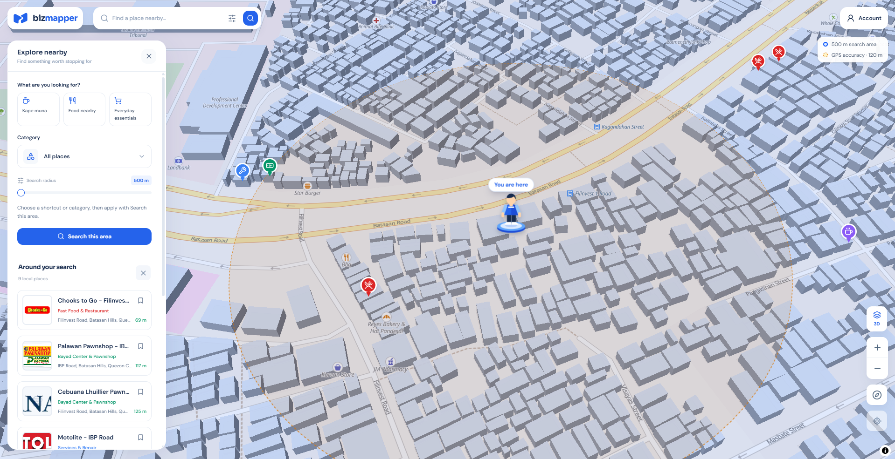
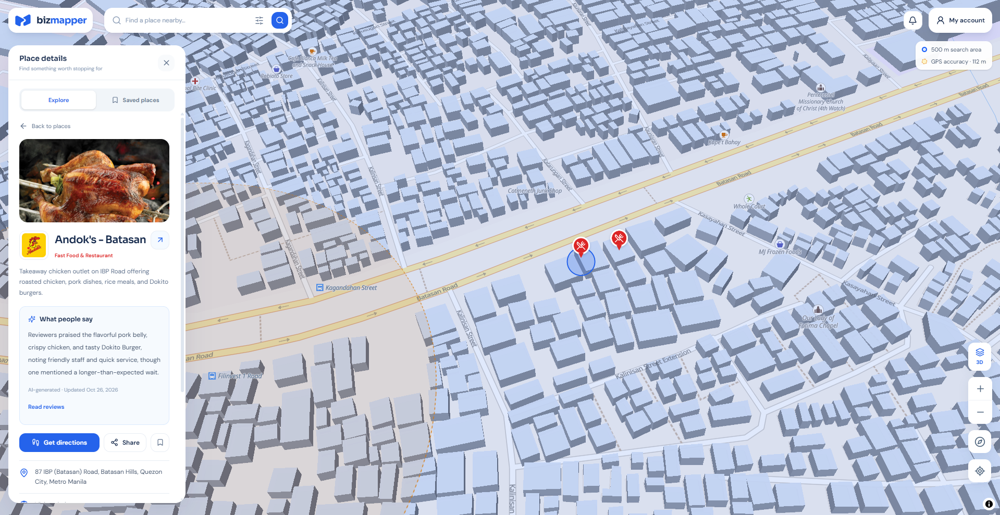
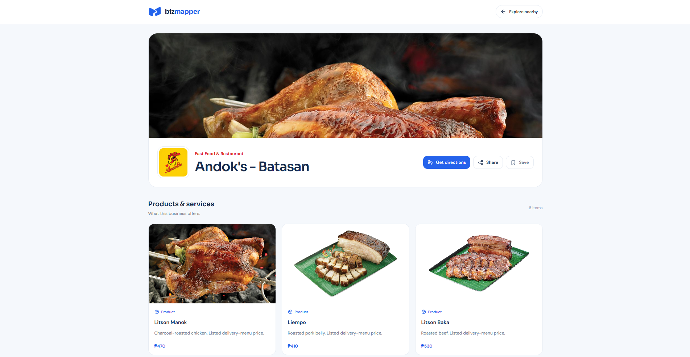
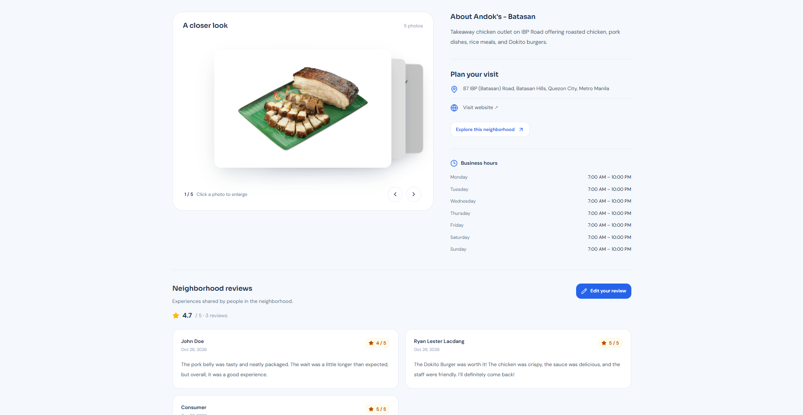
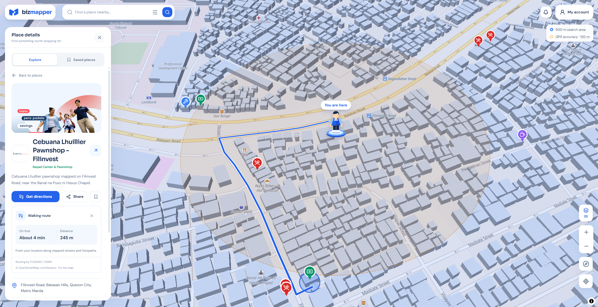
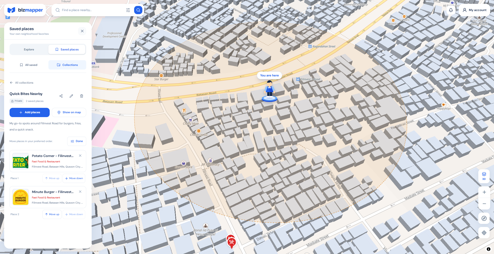
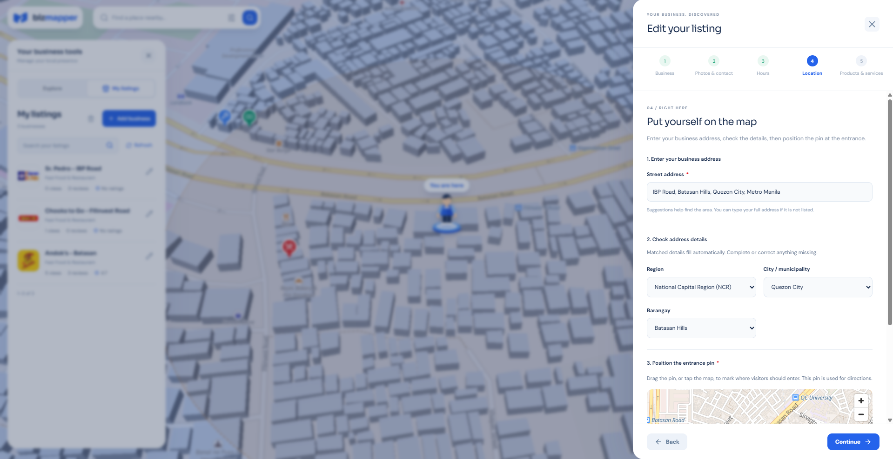

<p align="center">
    
</p>

<h1 align="center">BizMapper</h1>

<p align="center"><strong>Discover your neighborhood.</strong></p>

<p align="center">
    Explore nearby businesses on a 3D map, find a walking route, and keep your favorite places together.
</p>

<p align="center">
    <a href="#features">Features</a> &middot;
    <a href="#tech-stack">Tech stack</a> &middot;
    <a href="#gallery">Gallery</a> &middot;
    <a href="#getting-started">Getting started</a>
</p>

BizMapper is a neighborhood business directory focused on the Philippines. Guests, consumers, and business owners share one map explorer, with tools for discovering places, managing listings, and sharing local recommendations.



## Features

### Explore nearby

- Interactive 3D map with a 2D toggle, category markers, and marker clustering.
- Location-based discovery with a default **500 m** search radius.
- Keyword search, category filters, and shortcuts for coffee, food, and everyday essentials.
- Explicit **Search this area** action to apply filter changes or search a new map area.
- Paginated nearby results with distances from the search center.
- Search state preserved in the URL for refreshing and sharing.
- A location marker and separate search-area and GPS-accuracy indicators.

### Learn about a business

- Public profiles with a cover image, logo, description, address, and contact links.
- Photo galleries with up to **five images** and enlarged previews.
- Products and services with photos and optional prices in Philippine pesos.
- Weekly operating hours displayed in a 12-hour format.
- Walking routes drawn directly on the map, with estimated distance and travel time.
- Shareable business links and optional social links.

### Save and share places

- Private bookmarks for consumer accounts.
- Collections with names, descriptions, and custom place ordering.
- Optional public collection links that their creators can disable again.
- Collection browsing with map highlighting and navigation between saved places.

### Reviews and AI summaries

- Star ratings, written reviews, and owner replies.
- Personal review history with editing and deletion.
- **What people say** summaries in map details and public business profiles.
- English summaries generated from published reviews, including English, Filipino, and Taglish input.
- Background generation after at least **three published reviews** and **60 seconds without another review change**.
- Reviews and listing actions remain usable when AI summaries are unavailable.

### Owner tools and accounts

- Owner and consumer registration, authentication, and account settings.
- A step-by-step listing editor for business details, photos and contact information, hours, location, and products or services.
- Street-address suggestions, Philippine administrative-area selection, and an adjustable map pin.
- Multiple-listing management, profile-view and review metrics, and deletion with restoration from Trash.
- An activity bell for new reviews and owner replies, with read controls.

## Tech stack

| Area                    | Technology                                                          |
| ----------------------- | ------------------------------------------------------------------- |
| Backend                 | PHP 8.3+, Laravel 13, Eloquent, Laravel Fortify                     |
| Frontend                | Vue 3, TypeScript, Inertia.js 3                                     |
| Styling and UI          | Tailwind CSS 4, Reka UI, Lucide icons                               |
| Maps                    | MapLibre GL JS, OpenFreeMap tiles, OpenMapTiles, OpenStreetMap data |
| Walking directions      | OSRM through the FOSSGIS routing service                            |
| Philippine addresses    | Laravel PSGC and Photon address lookup                              |
| AI summaries            | Laravel AI SDK, Groq, `openai/gpt-oss-120b`                         |
| Database                | MySQL; SQLite for automated tests                                   |
| Caching                 | Redis through Predis, with repository cache decorators              |
| Background processing   | Laravel queues and scheduler                                        |
| Animation               | GSAP and the business photo depth carousel                          |
| Build and route tooling | Vite 8 and Laravel Wayfinder                                        |
| Quality checks          | Pest, Laravel Pint, ESLint, Prettier, Vue TypeScript checks         |

## Gallery

The explorer above shows the main discovery flow. Expand the screenshots below to see the other features.

<details>
<summary><strong>Place details and AI review summary</strong></summary>

Read a business overview and its review summary while keeping the selected location visible on the map.



</details>

<details>
<summary><strong>Public business profile and product catalog</strong></summary>

View the business identity, cover photo, sharing actions, and products in a dedicated profile.



</details>

<details>
<summary><strong>Photo gallery, operating hours, and reviews</strong></summary>

Browse business photos, check the weekly schedule, and read neighborhood reviews.



</details>

<details>
<summary><strong>Walking directions</strong></summary>

See a walking route, estimated journey time, and distance without leaving the explorer.



</details>

<details>
<summary><strong>Saved places and custom collections</strong></summary>

Organize bookmarked businesses into collections, add descriptions, and change their order.



</details>

<details>
<summary><strong>Owner listing editor</strong></summary>

Create or update a listing through a guided editor with address selection and a movable location pin.



</details>

Screenshots use local demonstration data, including sample reviews and operating hours. Business imagery and brand marks belong to their respective owners.

## Getting started

### Requirements

- PHP **8.3+** and Composer.
- Node.js **22.12+** and npm.
- A MySQL database and a running Redis instance.
- A browser with WebGL support and internet access for map tiles and routing.
- A Groq API key if you want to generate AI review summaries.

### Configure the environment

Copy `.env.example` to `.env`, create an empty MySQL database, and update the values below before running setup. Set `APP_URL` to the URL you use locally, such as `http://localhost:8000` or your Laravel Herd site.

```dotenv
APP_NAME=BizMapper
APP_URL=http://localhost:8000

DB_CONNECTION=mysql
DB_HOST=127.0.0.1
DB_PORT=3306
DB_DATABASE=biz_mapper
DB_USERNAME=root
DB_PASSWORD=

CACHE_STORE=redis
REDIS_CLIENT=predis
REDIS_HOST=127.0.0.1
REDIS_PORT=6379

QUEUE_CONNECTION=database
AI_SUMMARY_QUEUE_CONNECTION=database
AI_SUMMARIES_ENABLED=true
GROQ_API_KEY=
```

Repository caching uses Redis tags. Set the Redis values above even though the starter environment template defaults to database caching. Keep the Groq key on the backend; it does not need a `VITE_` variable.

### Set up the application

```sh
composer run setup
```

This installs PHP and JavaScript dependencies, generates the application key, runs migrations, and builds the frontend assets.

Then add the initial categories, Philippine address data, and public upload link:

```sh
php artisan db:seed --class=CategorySeeder
php artisan db:seed --class=PSGCSeeder
php artisan storage:link
```

These seeders add business categories and Philippine address data. Register an owner account in the application to create listings, or a consumer account to save places and write reviews.

### Run locally

```sh
composer run dev
```

This starts the Laravel development server, queue listener, scheduler, and Vite together. Use HTTPS or localhost for browser location access. Location accuracy depends on the device and browser.

The scheduler automatically runs the AI summary dispatch command, so no separate command is needed. A review change resets the 60-second quiet period; scheduler recovery can add up to another minute.

## Development checks

```sh
php artisan test
composer lint:check
npm run types:check
npm run lint:check
npm run format:check
npm run build
```

AI tests use SDK fakes and do not require a live Groq key.

## Map credits

Map tiles are provided by [OpenFreeMap](https://openfreemap.org/) using [OpenMapTiles](https://openmaptiles.org/) and [OpenStreetMap contributors](https://www.openstreetmap.org/copyright). Walking routes use the [FOSSGIS routing service](https://routing.openstreetmap.de/) powered by OSRM.
